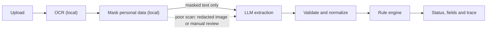
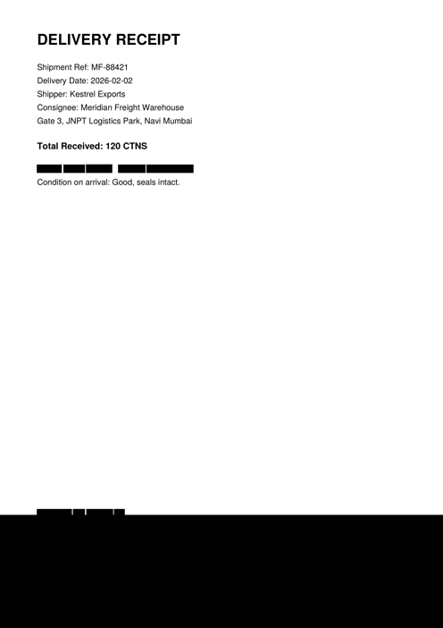

# Meridian Intelligence

**Privacy-first document intelligence, starting with warehouse receiving.**

Receiving clerks at Meridian Freight compare quantities on shipping paperwork by eye. If they miss a mismatch, the wrong cartons get put away after the truck has left. This app reads the documents and answers one question: **does the invoice quantity match the packing list?**

Personal data is masked on our own machine before any model call, and code makes the final decision, not the model.

> Team Delta, Build Fast with AI OCR Connector project. Meridian Freight is fictional, and every document here is synthetic.

| | |
|---|---|
| **Live demo** | Not deployed yet; ready to deploy with [docs/DEPLOY.md](docs/DEPLOY.md) |
| **Accuracy** | Measured on synthetic documents only ([see Evaluation](#evaluation)) |
| **Architecture** | [docs/ARCHITECTURE.md](docs/ARCHITECTURE.md) |

## How it works



| Step | What happens |
|---|---|
| **Upload** | Accepts PDF, PNG or JPEG up to 10 MB. Checks file bytes, not the extension, and stores under a random ID. |
| **Read** | Tesseract runs locally. Under 40 letters or digits, or confidence under 60, takes the fallback path. |
| **Mask** | Presidio and custom recognizers replace personal data with placeholders such as `<PERSON_1>`. |
| **Extract** | One model call picks the document type and fills six fields. |
| **Check** | Code compares quantities and returns the status. |

## Architecture

The design is a modular monolith with background workers and an API-first design. The API, the pipeline and the Meridian rules are separate layers, so new document workflows can reuse the platform.

| Layer | Today | Planned |
|---|---|---|
| Experience | Streamlit page and trace panel; Next.js shipments, comparison, exceptions, review, dashboard, observability and settings | Testing every screen end to end |
| Edge and security | CORS limit, file checks, rate limiting, Clerk sign-in, roles | HTTPS and WAF when deployed |
| Control plane | FastAPI endpoints for extraction, organizations, shipments, jobs, review and audit | Customer API keys and webhooks |
| Data and messaging | PostgreSQL, Redis queue, local or S3-compatible temporary storage | SQS, if chosen during AWS work |
| Document intelligence | All stages, in the API for `/v1/extract` and in Celery workers for jobs | Scaling workers apart in production |
| Observability | Spans, safe logs, counters, summary screen | Collector and dashboards |

[docs/ARCHITECTURE.md](docs/ARCHITECTURE.md) has all six diagrams, each labelled by status.

```text
app/
  main.py            HTTP routes
  core/              Settings, errors, telemetry
  ingestion/         Upload checks, storage, .eml attachments
  pipeline/          OCR, PII masking, vision fallback, LLM, runner
  domains/meridian/  Schemas, prompt, business rules
ui/                  Streamlit page
web/                 Next.js product UI, see web/README.md
scripts/             Sample generation and evaluation
samples/             Synthetic documents and test sheets
tests/               Automated tests
docs/                Architecture
```

## Quick start

You need Python 3.13, [Tesseract](https://github.com/tesseract-ocr/tesseract) and [Poppler](https://poppler.freedesktop.org/) on your PATH.

```bash
python -m venv .venv
source .venv/bin/activate              # Windows: .venv\Scripts\activate
pip install -r requirements.txt
python -m spacy download en_core_web_lg
cp .env.example .env                   # Windows: copy .env.example .env
```

Add your key to `LLM_API_KEY` in `.env`. The key only ever comes from the environment.

Run each of these in its own terminal:

```bash
uvicorn app.main:app --reload --port 8000
```

```bash
streamlit run ui/streamlit_app.py
```

The API docs are at `http://localhost:8000/docs` and the page is at `http://localhost:8501`.

**With Docker instead:** set `POSTGRES_PASSWORD` in `.env`, then run the command below. It starts the API, a background worker, the page, PostgreSQL and Redis. Create the tables with `docker compose exec api alembic upgrade head`. `POST /v1/extract` needs neither PostgreSQL nor Redis.

```bash
docker compose up --build
```

**No key yet?** Set `LLM_PROVIDER=mock` to use a regex stand-in tuned to the samples. It's for development only, so don't demo it or report its accuracy.

## API

`POST /v1/extract` takes a multipart upload: `file` is required, and `file2` is optional for the pair check.

```bash
curl -F "file=@samples/S02_invoice.pdf" -F "file2=@samples/S02_packing.pdf" http://localhost:8000/v1/extract
```

Example response shape:

```json
{
  "request_id": "7c1e0a4e-3d2b-4f0a-9c11-2a9b0e6d4f18",
  "document_type": "commercial_invoice",
  "fields": {
    "invoice_number": "MF-88421",
    "shipper_name": "Kestrel Exports",
    "receiver_name": "Meridian Freight Warehouse",
    "shipment_date": "2026-02-02",
    "total_quantity": 120,
    "total_weight_kg": 860.5
  },
  "check": {
    "status": "Match",
    "reason": "Invoice quantity equals packing-list quantity (120 cartons)."
  },
  "pii": {
    "masked_before_llm": true,
    "entity_counts": {"PERSON": 1, "IN_MOBILE": 1},
    "placeholder_count": 2
  },
  "pipeline": {
    "ocr_engine": "tesseract",
    "used_vision_fallback": false,
    "model": "gemini-3.1-flash-lite",
    "prompt_version": "meridian-v2",
    "timings_ms": {"ocr": 640, "pii": 38, "llm": 1102, "rule": 3}
  },
  "documents": []
}
```

Top-level `document_type` and `fields` describe the first file. `documents` has one entry per file, so a pair shows both.

| Endpoint | Purpose |
|---|---|
| `POST /v1/extract` | One file or a pair |
| `POST /v1/extract-eml` | Every PDF or image attachment in an `.eml` file (stretch goal) |
| `GET /v1/trace/last` | Sanitized trace of the last request |
| `GET /v1/metrics` | Counters |
| `GET /healthz` | Health check |
| `GET /v1/me` | The signed-in user and their organizations; needs a Clerk token |
| `POST /v1/organizations` | Start an organization and become its admin |
| `GET /v1/organization` | The current organization |
| `GET /v1/organization/members` | List members; supervisor or admin |
| `PATCH /v1/organization` | Rename the organization; admin |
| `POST /v1/organization/members` | Add someone who has already signed in; admin |
| `PATCH /v1/organization/members/{user_id}` | Change a role; admin |
| `DELETE /v1/organization/members/{user_id}` | Remove a member; admin |
| `POST /v1/shipments`, `GET /v1/shipments` | Create and list shipments |
| `GET /v1/shipments/{id}` | One shipment, with its documents and jobs |
| `POST /v1/shipments/{id}/documents` | Upload a document for a later job |
| `POST /v1/shipments/{id}/jobs` | Start a background check; returns 202 and supports `Idempotency-Key` |
| `GET /v1/jobs/{id}` | Job status and saved results |
| `GET /v1/exceptions` | Open mismatches and manual review cases |
| `GET`, `POST /v1/jobs/{id}/reviews` | Read reviews, or record one with a reason; supervisor or admin |
| `GET /v1/analytics/summary` | Counts for the organization |
| `GET /v1/observability/summary` | Latest trace, timings and counts from saved jobs; supervisor or admin |
| `GET /v1/audit-events` | Newest audit events for the organization; admin |

Errors return only `{"error": "Could not read this document.", "request_id": "..."}`. The server log records a class such as `ocr_engine_missing` or `schema_invalid`.

**Limits:**
- PDFs over 5 pages are refused, so a total on a later page is never silently missed.
- Each client can make 30 extract requests a minute by default (`RATE_LIMIT_PER_MINUTE`), and further requests get a 429.
- When `INTERNAL_API_TOKEN` is set, `/v1/trace/last` and `/v1/metrics` need it in the `X-Internal-Token` header. Set it when deployed.

## Sign-in

[Clerk](https://clerk.com) handles sign-up, sign-in, sign-out and password reset. The API only verifies Clerk's tokens, and creates a `users` row on first sign-in. `POST /v1/extract` stays open, as the assignment requires.

To set it up:
1. Create a Clerk application.
2. Set `CLERK_ISSUER` in `.env` to its Frontend API URL, and `CLERK_AUTHORIZED_PARTIES` to your page's address.
3. In the Clerk dashboard, go to **Sessions**, then customize the session token with `{"email": "{{user.primary_email_address}}"}`. Without this, tokens are refused.

**Organizations:** a person's organization comes from their memberships, never a request body. `X-Organization-Id` picks one when they belong to several. Another organization's records return 404, and PostgreSQL row-level security enforces this even if a query forgets its filter.

## Business rules

| Status | When |
|---|---|
| **Match** | Both documents are present and the quantities are equal |
| **Mismatch** | Quantities differ, units differ, or a total can't be read |
| **Incomplete** | The invoice or the packing list is missing |
| **Not applicable** | Only delivery receipts were uploaded |

**Quantity unit:** `total_quantity` is the number on the total line, in the unit printed beside it. That unit is returned separately as `quantity_unit`.

**When a page prints two totals:** the field holds the shipping-unit total (cartons or packages), because put-away is by carton. The check still compares like with like, so an invoice for 1,200 pieces matches a packing list printing 50 cartons and 1,200 pieces. If no unit is shared, 120 cartons vs 1,440 pieces is a Mismatch. We never guess a pack size.

**Numbers:**
- `1,200` means 1200, and 120 equals 120.0.
- Code converts pounds to kilograms (× 0.45359237), not the model.
- Weight is displayed but never changes the status.

**Person-only shipper or receiver:** the placeholder stays in the field. The real name is never shown, and the schema doesn't grow.

## Privacy and security

| Rule | Where |
|---|---|
| Presidio runs before any network call, with Indian mobile, Aadhaar-shaped, PAN, bank account, IFSC, policy and roll number recognizers | `app/pipeline/pii.py` |
| Same person on two documents gets one placeholder; the map stays in memory and is cleared in `finally` | `app/pipeline/pii.py`, `app/pipeline/runner.py` |
| Masked text with a leftover email, mobile, Aadhaar or PAN shape blocks the model call, and model output is scrubbed | `app/pipeline/pii.py`, `app/pipeline/runner.py` |
| A receipt's bottom band is masked in the text path too | `app/pipeline/vision.py` |
| Only redacted images can go to a vision model; an unclear document type or no word boxes means manual review | `app/pipeline/vision.py`, `app/pipeline/llm.py` |
| File bytes checked, random names, deleted after the request | `app/ingestion/upload.py` |
| Telemetry uses an allow-list of keys | `app/core/telemetry.py` |
| Clients get a generic error; CORS is limited to our page | `app/main.py` |
| API key from the environment; `.env` is git-ignored | `.env.example` |

**Known gap:** street lines aren't reliably masked, so a personal address on a shipment that isn't company-to-company could reach the model.

To protect people's names, a company named only with words like "Mills" or "Global", with no word like "Ltd", gets masked too. That can lower shipper and receiver accuracy.

Hosted vision stays off unless `VISION_MODEL` is set. Before using a hosted provider, confirm its terms say prompts aren't used for training.



## Telemetry

Each request creates OpenTelemetry spans named `ocr`, `pii`, `llm` and `rule`. They're mirrored as one JSON object per line in `logs/telemetry.jsonl`:

```json
{"ts":"2026-10-30T12:04:11+00:00","level":"info","request_id":"7c1e0a4e-3d2b-4f0a-9c11-2a9b0e6d4f18","stage":"pii","duration_ms":38,"slot":1,"entity_counts":{"PERSON":2,"IN_MOBILE":1},"placeholder_count":3}
```

The page shows the last request's four stages, durations, status and entity counts. OCR text, prompts, completions, field values, the placeholder map and filenames are never recorded.

## Evaluation

Measured on 2026-11-04 with `gemini-3.1-flash-lite` on a paid plan, using prompt `meridian-v2`.

| Metric | Result with the real model |
|---|---|
| Field match after normalization | 120/120 = 100% |
| Document-type accuracy | 20/20 = 100% |
| Rule accuracy | 12/12 = 100% |

**Field match normalization:**
- Text is compared without case and with collapsed spaces.
- Dates are compared in ISO format.
- Quantities are compared as numbers.
- Weight must be within 0.5 kg.

**Test data:** 40 synthetic documents, a 20-document test sheet (`samples/test_sheet.csv`) with 8 pairs, and 12 rule cases (`samples/test_cases.csv`). They cover:
- matches at 40, 120 and 1,200
- 120 vs 118
- cartons vs pieces
- two totals on one page
- weight in pounds
- scanned images
- signed receipts
- one faint scan meant for manual review

**Holdout set (unseen documents):** the test sheet above is drawn from the same templates the prompt and masking were developed on, so it can overstate accuracy. `scripts/make_holdout.py` writes 14 documents to `samples/holdout/` that differ on purpose: a two-column header, new labels ("Exporter", "Ship To", "Total Packages", "Proof of Delivery"), new reference formats such as `INV/2026/0417`, and companies with no word like "Ltd" in their name (Ashwood Mills, Halden & Brook, Tarang). The 8 rule cases include digits swapped (250 vs 205) and pallets vs cartons. Run it with:

```bash
python scripts/evaluate.py --sheet samples/holdout/holdout_sheet.csv --cases samples/holdout/holdout_cases.csv
```

| Metric | Holdout result with the real model |
|---|---|
| Field match after normalization | 84/84 = 100% |
| Document-type accuracy | 14/14 = 100% |
| Rule accuracy | 8/8 = 100% |

**Read these numbers with care.** The first holdout run scored 94.0% on fields and 87.5% on rules. It found three bugs, which were fixed before this run, so these documents are no longer truly unseen. All documents are synthetic, so real scans may score lower.

With the API running:

```bash
python scripts/evaluate.py
```

```bash
pytest -q
```

## Demo script

1. Upload `S02_invoice.pdf` and `S02_packing.pdf`: **Match** (120 vs 120).
2. Upload `S04_invoice.pdf` and `S04_packing.pdf`: **Mismatch** (120 vs 118).
3. Upload `S02_receipt.pdf` alone: **Not applicable**, with `SIGNATURE` in the entity counts.
4. Open the trace: durations and a Match label, with no phone number or email.
5. Stretch: upload `packet_S02_match.eml`: three documents and one Match.

## Roadmap

1. **Fellowship release:** real accuracy numbers, privacy fixes, live demo.
2. **Platform:** PostgreSQL, authentication, tenants, roles, background workers, Next.js.
3. **Workflow automation:** email ingestion, document grouping, exception management.
4. **Integrations:** ERP, warehouse and transport systems, webhooks.
5. **General platform:** configurable schemas and rules for other industries.
