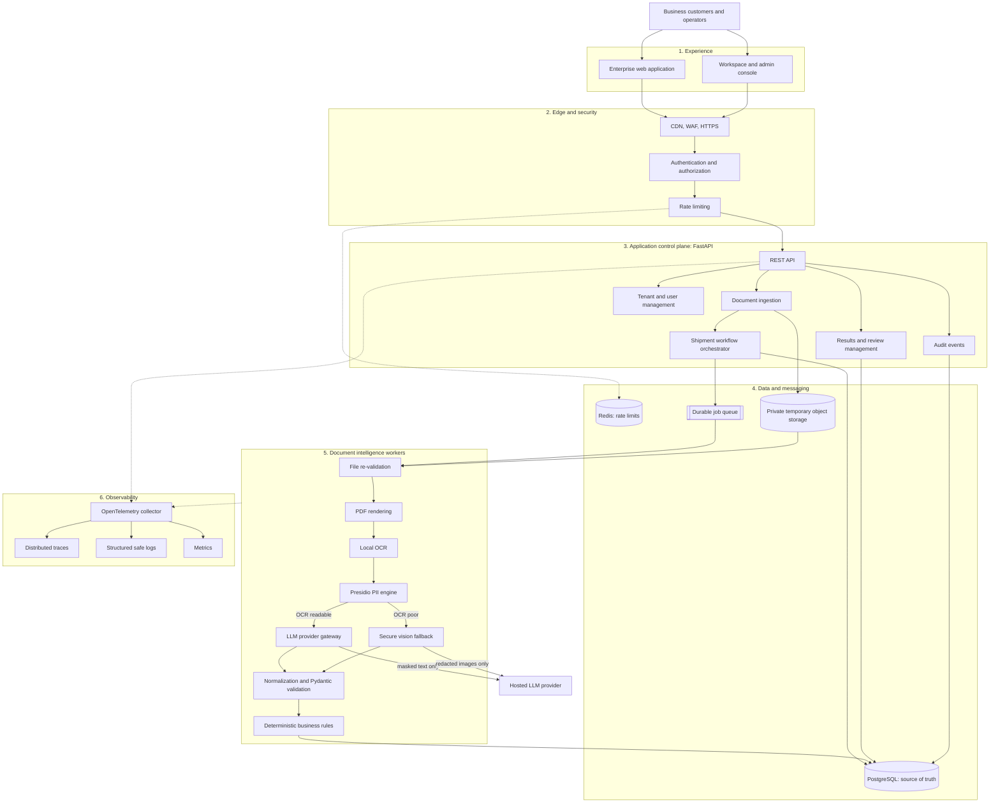
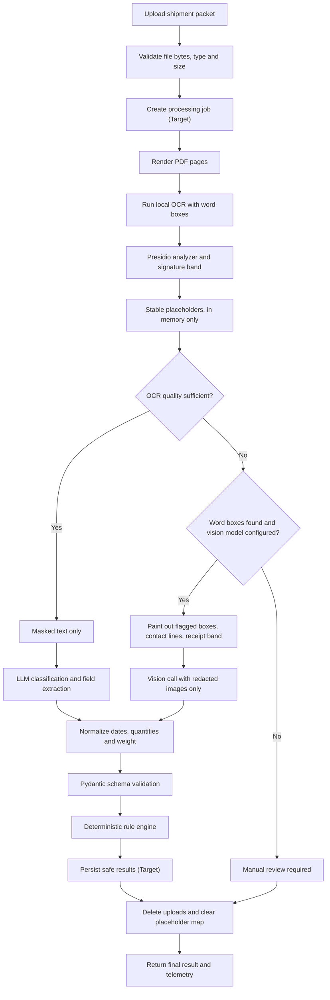
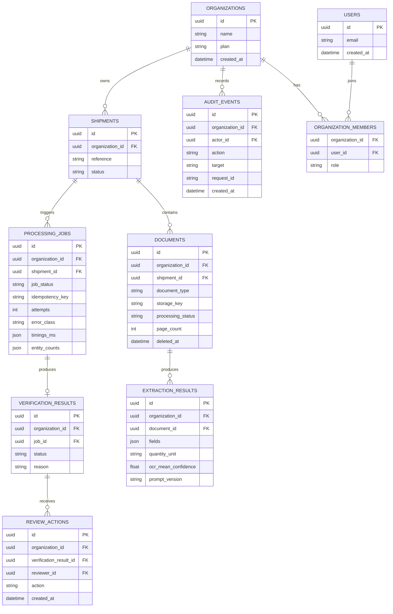
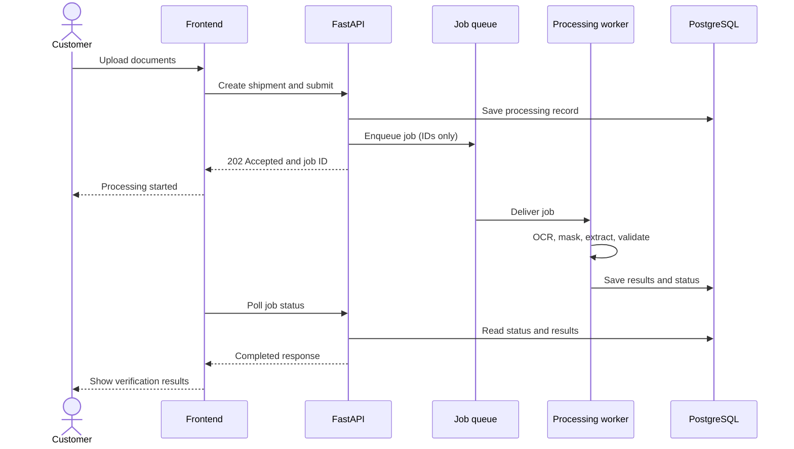
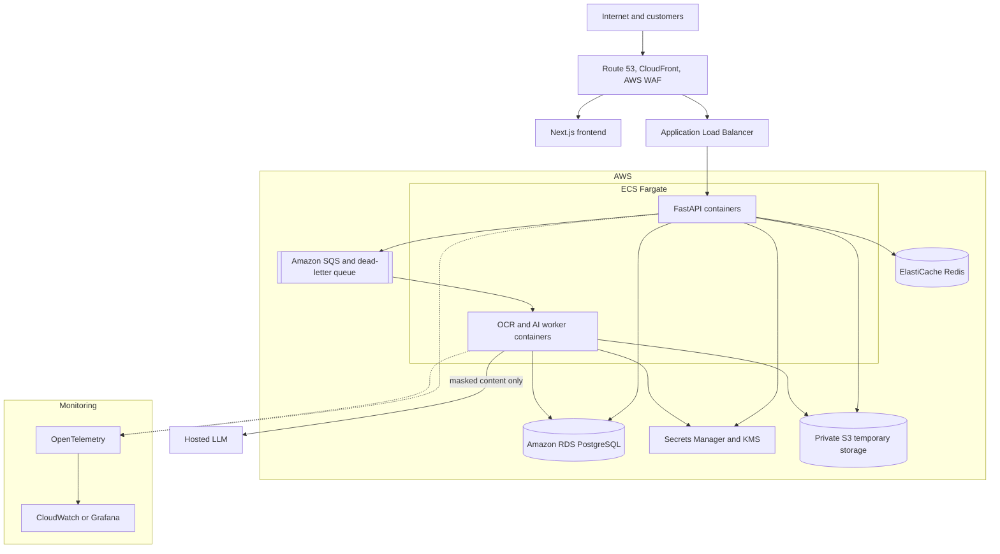
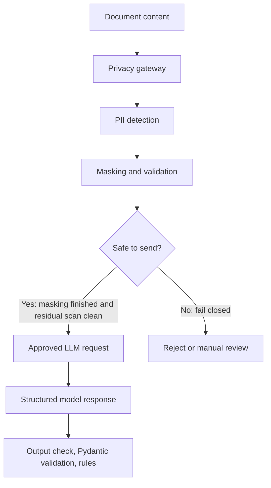

# Architecture

This document is the team's source of truth for how the product is designed. The style is a **modular monolith with independently scalable background workers and an API-first design**, without microservices.

Each diagram is labelled:
- **Built:** the code in this repo does this today.
- **Target:** the agreed design, not built yet.
- **Partly built:** the status table or a note says which parts exist.

## What exists today

| Layer | Built | Target |
|---|---|---|
| 1. Experience | Streamlit clerk page with trace panel | Next.js web app and admin console |
| 2. Edge and security | CORS limit, file checks, 10 MB cap, rate limiting, Clerk token verification | HTTPS, WAF, sign-in screens, authorization |
| 3. Control plane | Stateless `POST /v1/extract` and `/v1/extract-eml`; organizations, members, roles and audit events | Shipments, jobs, review |
| 4. Data and messaging | Temporary local files, deleted after each request; PostgreSQL schema and migrations, not yet used by the app | App use of PostgreSQL, Redis, job queue, private object storage |
| 5. Document intelligence | All stages, running inside the API process | The same stages in separate workers |
| 6. Observability | OpenTelemetry spans, safe JSON logs, in-memory counters | Collector, Grafana or CloudWatch dashboards |

## Code layers

```text
app/
  main.py            Control plane: HTTP routes
  core/              Platform: settings, errors, telemetry
  ingestion/         Platform: upload checks, storage, .eml attachments
  pipeline/          Document intelligence: OCR, PII, vision, LLM, runner
  domains/meridian/  Meridian only: schemas, prompt, business rules
ui/                  Experience: Streamlit page
```

A new document workflow should add a folder under `domains/`. `pipeline/` still imports Meridian's schemas and rules directly, so that boundary needs an interface before a second domain is added.

## 1. Complete system architecture

**Status: Target.** The status table above shows what exists today.



## 2. Detailed document-processing architecture

**Status: Partly built.** The steps match the code, except that job creation and saving results are Target.



Every path reaches the cleanup step, including failures. Normalization and validation run together inside the Pydantic models.

## 3. Production database architecture

**Status: Partly built.** The tables and migrations exist in `app/db/models.py` and `migrations/`, but the app doesn't read or write them yet.



Rules for this schema:
- Every tenant table carries `organization_id`, and foreign keys between tenant tables include it. PostgreSQL row-level security also limits each signed-in request to one organization.
- No table stores original filenames, OCR text, prompts or the placeholder map.
- Audit events are append-only for signed-in requests, and hold record IDs, never field values.
- `storage_key` is cleared once the file is deleted.

## 4. API architecture

**Status: Target for the job flow.** `POST /v1/extract` stays synchronous, as the assignment requires, and is what exists today. Both flows must share one pipeline.



| Endpoint | Status | Purpose |
|---|---|---|
| `POST /v1/extract` | Built | One file or a pair; returns the full result |
| `POST /v1/extract-eml` | Built | Every attachment in an `.eml` file |
| `GET /v1/trace/last` | Built | Sanitized trace of the last request |
| `GET /v1/metrics` | Built | Counters |
| `GET /healthz` | Built | Health check |
| `POST /v1/shipments` | Target | Create a shipment |
| `POST /v1/shipments/{id}/documents` | Target | Add documents |
| `POST /v1/shipments/{id}/jobs` | Target | Start processing; returns 202 |
| `GET /v1/jobs/{id}` | Target | Job status and result |
| `POST /v1/results/{id}/reviews` | Target | Record a human review |
| `/v1/organizations`, `/v1/users`, `/v1/analytics`, `/v1/audit-events` | Target | Administration and reporting |

## 5. Production deployment architecture

**Status: Target.** Nothing is deployed yet.



## 6. Security architecture

**Status: Partly built.** Masking, the "Safe to send?" residual scan, the fallback rule, output scrubbing, generic errors, token verification and tenant isolation exist. There's no separate gateway component yet, and sign-in screens and network limits are Target.



Controls across the system:

| Control | Rule |
|---|---|
| Model calls | Only masked text or redacted images leave the machine |
| Placeholder map | In memory for one request, cleared in `finally` |
| Uploads | Bytes checked, random names, deleted after processing |
| Telemetry | Allow-listed keys only; never text, prompts, values or filenames |
| Client errors | Generic message; the log records only an error class |
| Secrets | Environment variables only; `.env` is never committed |
| Business decision | Deterministic code, never the model |

## Decisions

**Requests switch to a restricted database role (2026-11-02).** PostgreSQL superusers skip row-level security, and the database user in `docker-compose.yml` is one. Each signed-in request therefore runs `SET LOCAL ROLE meridian_app`, so the policies always apply. A deployed app should also connect as a non-superuser.

**Sign-in uses Clerk (2026-11-02).** It's the fastest route to sign-up, sign-in and password reset, and works well with the planned Next.js app. The API only verifies signed tokens with Clerk's public keys, so it holds no passwords. The trade-offs are an outside service holding user emails, and a pricing dependency to review before launch. AWS Cognito was the alternative: it keeps users in our AWS account, but it's slower to set up and harder to test locally.

## Corrections made to the original diagrams

The six diagrams keep their original design, with these fixes:

1. Presidio runs before image redaction, because redaction needs its results.
2. The vision call is the extraction call, so it joins at normalization instead of passing through Presidio and a second model call.
3. Normalization happens with validation, because `"1,200"` fails a plain integer check.
4. Workers save to PostgreSQL only and don't call the results module directly.
5. Workers now read from storage, and PDF rendering appears in the system diagram.
6. Files are validated at the API before a job exists, then re-checked by the worker.
7. Verification results link to a job, so re-runs keep their history.
8. Added `organization_id` on tenant tables, roles, review actions and fields the empty tables lacked.
9. "Safe to send?" now has defined criteria, and model output gets checked.

The manual review path still needs a safe status saved once the database exists, so the exception center has a record to show.
